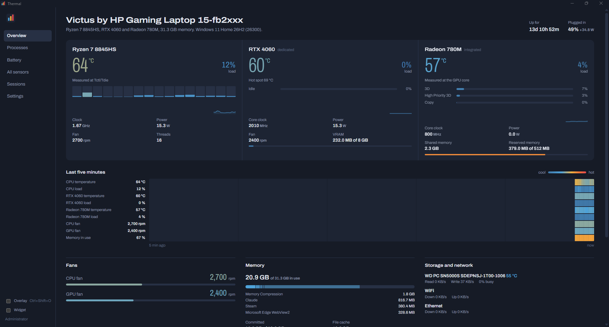
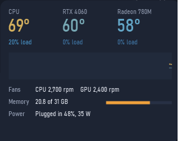
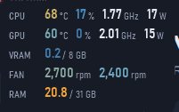
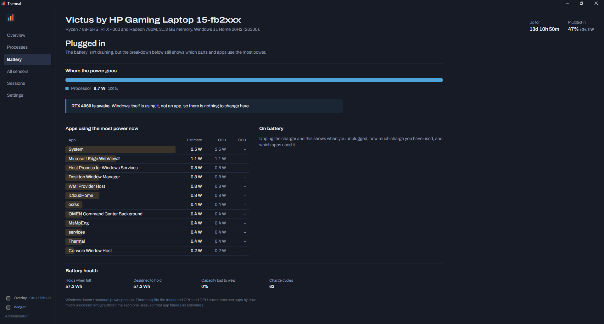

# Thermal

A hardware monitor for Windows laptops. It shows temperatures, fan speeds, both GPUs side by side, which app is using which GPU, where your battery is going, and a frame-rate overlay for games.

It was built and tested on an HP Victus 15 (Ryzen 7 8845HS, RTX 4060 Laptop, Radeon 780M). It runs on any 64-bit Windows 10 or 11 PC; how many sensors it can read depends on the hardware, see [Will it work on my PC?](#will-it-work-on-my-pc)



| Desktop widget | Game overlay |
| --- | --- |
|  |  |



## Install

You need Windows 10 or 11 on a 64-bit Intel or AMD processor. Nothing else: the .NET runtime is built in, and WebView2 comes with Windows 11 and up-to-date Windows 10.

1. Download **[Thermal-Setup.exe](../../releases/latest/download/Thermal-Setup.exe)** from the latest release.
2. Run it. Windows SmartScreen may say "Windows protected your PC", because the app isn't code-signed yet: choose **More info**, then **Run anyway**.
3. Approve the administrator prompt, finish the installer, and Thermal opens. It's in the Start menu from then on.
4. If Thermal shows a note about PawnIO, click **Install PawnIO**. That small signed driver lets it read the CPU's exact temperature and power on AMD and Intel processors. Until it's installed, the CPU temperature is an estimate.

Thermal asks for administrator rights each time it starts, because fan speeds, CPU sensors and the frame-rate counter need them. To start it with Windows without that prompt, turn on **Start with Windows** in Settings.

Prefer not to install anything? **[Thermal.exe](../../releases/latest/download/Thermal.exe)** is the same app as one portable file. Run it from any folder.

**Uninstall** from Settings > Apps > Installed apps > Thermal. That also removes the Start with Windows task. Your settings stay in `%APPDATA%Thermal` and recorded sessions in `DocumentsThermal sessions`; delete them by hand if you want them gone.

### Installing from a terminal, or with an AI assistant

These commands work in PowerShell. An assistant such as Claude Code can run them too, but a person still has to approve the administrator prompt.

```powershell
$setup = "$env:TEMPThermal-Setup.exe"
Invoke-WebRequest https://github.com/zubair2901/thermal/releases/latest/download/Thermal-Setup.exe -OutFile $setup
Start-Process $setup -ArgumentList "/VERYSILENT", "/SUPPRESSMSGBOXES", "/NORESTART" -Verb RunAs -Wait
```

Optional, for exact CPU temperature and power:

```powershell
winget install --id namazso.PawnIO -e
```

Then open **Thermal** from the Start menu.

## Will it work on my PC?

| Part | What to expect |
| --- | --- |
| Windows version | Windows 10 or 11, 64-bit (x64). Not Windows on ARM (Snapdragon laptops), macOS or Linux. |
| CPU | Intel and AMD: load per thread, clock. Temperature and package power need PawnIO (see Install). |
| Graphics | NVIDIA, AMD and Intel, dedicated or integrated. Per-app GPU use comes from Windows itself, so it works with any brand. |
| Hybrid-graphics laptops | Thermal only reads the dedicated GPU's sensors while an app is using it, so the GPU can still sleep on battery. |
| Fan speeds | HP Omen and Victus laptops: CPU and GPU fan RPM through the HP BIOS. Desktops: whatever the motherboard's sensor chip reports. Many Dell, Lenovo, ASUS and Acer laptops hide their fans from Windows, and Thermal shows "No fan sensors" there. |
| Battery view | Laptops only. Desktops hide it. |
| Frame rate | DirectX 9 to 12 games, and Vulkan or OpenGL games that present through DXGI. Exclusive-fullscreen games hide every overlay. |

So far Thermal has only been tested on the HP Victus above. If something is missing or wrong on your machine, open an issue and attach the output of `Thermal.exe --dump sensors.json` (run as administrator).

### CPU temperature and power on AMD and Intel

LibreHardwareMonitor reads the CPU die temperature and package power through the [PawnIO](https://pawnio.eu) driver. If it isn't installed, Thermal shows an **Install PawnIO** button (it runs `winget install namazso.PawnIO`) and uses an approximate temperature until then.

## What it shows

- **Overview**: CPU and each GPU with temperature, load, clocks, power and fan speed; load per CPU thread; GPU load per engine (3D, copy, video); VRAM; a five-minute heat history of every sensor; memory, storage, network and the apps doing the most work.
- **Processes**: CPU, memory, GPU load and which GPU it runs on, GPU memory, disk I/O and threads per app. Group by app, sort, filter, end task.
- **Battery**: current drain in watts and time left; how the power splits between CPU, each GPU and the rest of the laptop; estimated watts per app; energy each app used since you unplugged; which apps keep the dedicated GPU awake; battery wear and charge cycles.
- **All sensors**: every reading LibreHardwareMonitor exposes, with lowest and highest values.
- **Sessions**: record a game or workload to CSV, one row per second, and see lowest, average and highest for each reading.

Windows doesn't measure power per app, so Thermal splits the measured CPU and GPU power between apps by their share of processor and graphics time. Treat per-app watts as estimates.

## Overlay, widget, alerts and tray

- **Game overlay**: click-through readout of frame rate (with 1% low and frame time), CPU, GPU, VRAM, fans, memory and battery. Toggle it with **Ctrl+Shift+O**, or choose another shortcut, corner, size and lines in Settings. It shows over windowed and borderless games; games in exclusive fullscreen hide every overlay, including this one.
- **Frame rate** comes from the DXGI and Direct3D 9 present events (the same ETW events PresentMon reads), for whichever app is in the foreground. It covers DirectX 9 to 12 games, and Vulkan or OpenGL games that present through DXGI.
- **Desktop widget**: drag it anywhere, right-click for options, double-click to open Thermal.
- **Alerts**: a Windows notification when the CPU or a GPU stays above its limit (95 °C and 87 °C for 30 seconds by default), naming the busiest app.
- **Tray**: the tray icon shows the CPU temperature. Closing the window keeps Thermal running in the tray; right-click the icon and choose **Exit** to quit. **Start with Windows** adds a logon task, so Thermal starts in the tray without an administrator prompt.
- **Read the dedicated GPU's sensors**: reading the RTX through NVAPI keeps it awake. Turn this off on battery and the GPU can sleep; load and per-app GPU use still come from Windows' own counters.

## How it's built

| Part | Where | What |
| --- | --- | --- |
| Host | `app/MainForm.cs` | .NET 8 WinForms window with WebView2. Serves the UI from embedded resources and sends a JSON snapshot every second. |
| Sensors | `app/Telemetry/Collector.cs` | LibreHardwareMonitorLib for CPU, GPU, storage, network and battery. |
| HP fans | `app/Telemetry/HpBios.cs` | HP `hpqBIntM` WMI BIOS calls, following the OmenMon project's notes. |
| Per-app GPU | `app/Telemetry/Counters.cs`, `Dxgi.cs` | "GPU Engine" and "GPU Process Memory" performance counters, mapped to adapters through DXGI LUIDs. |
| Frame rate | `app/Telemetry/Fps.cs` | Real-time ETW session on the DXGI and D3D9 providers. |
| Battery | `app/Telemetry/Power.cs` | Per-app power attribution, energy since unplugged, battery health from WMI. |
| Sessions, alerts | `app/Telemetry/Recorder.cs`, `Alerts.cs` | CSV logging with min/avg/max; sustained-temperature notifications. |
| Overlay, widget, tray | `app/Hud.cs`, `app/Tray.cs` | Native layered windows drawn with GDI+, so they cost little while gaming. |
| UI | `ui/` | React, TypeScript and Vite. Charts are drawn on canvas; Archivo variable font. |

### Build

Requirements: Node 20+, .NET 8 SDK.

```
cd ui && npm ci && npm run build
cd ../app && dotnet publish -c Release -o ../dist
```

The installer is built with [Inno Setup](https://jrsoftware.org/isinfo.php): `iscc installer/thermal.iss`. Pushing a `v*` tag runs `.github/workflows/release.yml`, which builds both and attaches them to the GitHub release.

`npm run dev` in `ui/` runs the interface in a browser with synthetic data. `THERMAL_DEV_URL=http://localhost:5179` points the desktop window at the dev server, and `THERMAL_DEVTOOLS=1` enables the WebView2 inspector. `Thermal.exe --dump out.json` writes three readings to a file, which helps when a sensor is missing.

Settings live in `%APPDATA%\Thermal\settings.json`, logs in `%LOCALAPPDATA%\Thermal`, and recorded sessions in `Documents\Thermal sessions`.

## License

MIT. See [LICENSE](LICENSE) and [THIRD-PARTY-NOTICES.md](THIRD-PARTY-NOTICES.md).
